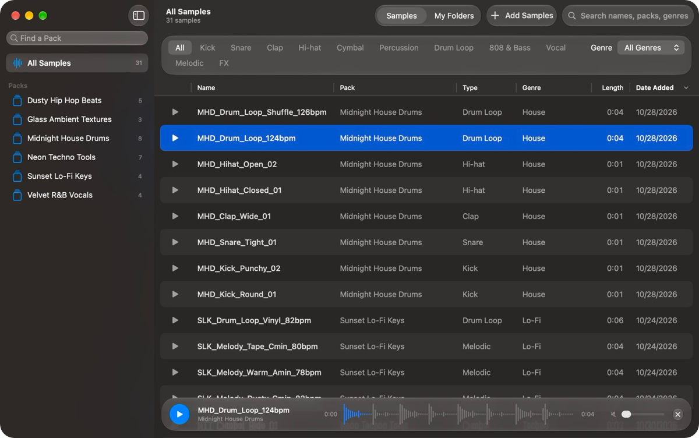
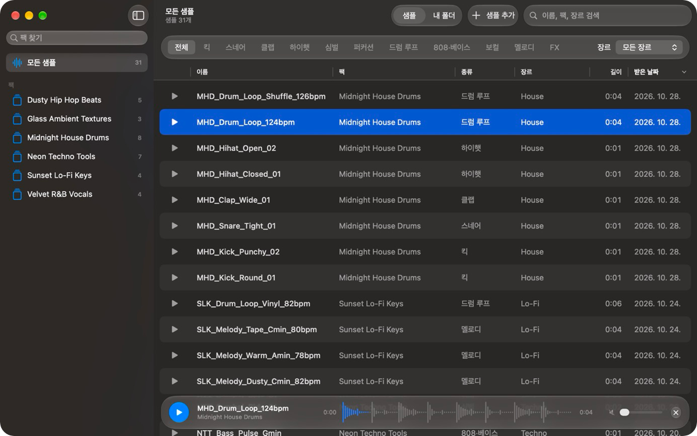

  

<h1 align="center">Sampl Moa</h1>

All your samples in one place, ready to hear, play and use.

  <a href="https://github.com/Lantern111/Sampl_Moa/releases/latest"><strong>Download for Mac</strong></a>
  · macOS 14 or later

<a href="#english">English</a> · <a href="#한국어">한국어</a>

## English

Sampl Moa is a free Mac app that gathers the samples scattered across your computer, so you can hear them instantly and drag them straight into your project. Its built-in sampler lets you play them on pads, too.

### Features

- **Connects automatically:** Finds the samples you've downloaded with Splice, even if you use more than one Splice account.
- **My Folders:** Add any folder to see all its audio files, including subfolders. This also works if you don't use Splice.
- **Instant preview:** Listen with the play button or the keyboard, and see the real waveform in the player.
- **Find what you need:** Filter by type, pack, and genre, or search by name.
- **Tempo:** Loops show their BPM, read from Splice or from the file name, and you can sort by it.
- **Drag and drop:** Drag samples into Logic Pro, Final Cut Pro, Premiere Pro, or After Effects. The original files stay where they are.
- **iCloud status:** Files that aren't downloaded yet show a cloud icon, which disappears once the download finishes.
- **English and Korean:** Change the language in Settings.

### Sampler

Choose **Sampler** in the toolbar, or press ⇧⌘S, to play your samples on pads and record what you play.

- **64 pads:** Four banks of 16, A to D, as on an MPC, plus one sound to play across the keys. Drag samples from the list onto a pad.
- **MIDI controllers:** An Akai MPK mini works as soon as it's plugged in. Teach any other controller its pads and knobs, and its setup is remembered. No controller? Play from your Mac's keyboard.
- **Recording:** Record loops over a click, with a count-in, tap tempo, quantize, and swing.
- **Send to your DAW:** Export the whole loop as one audio file, each pad as its own file, or just the notes as a MIDI file, then drag them into your project.
- **Shaping sounds:** Trim a sound, play it once, while held, or on a loop, change its pitch and speed, and chop it into slices across the pads. Choke groups let a closed hi-hat cut off an open one.
- **Tempo:** A loop's tempo is read from Splice or its name, and the loop can follow the sampler's tempo without changing pitch.
- **Mixing:** Every pad has EQ, a filter, pan, a fader, and stereo meters, laid out like Logic Pro's inspector, and the master has all of them but pan. Add the built-in reverb, delay, filters, distortion, compressor, and limiter, or your own Audio Unit plug-ins.

### Keyboard Shortcuts

| Key | Action |
|---|---|
| Space | Play or pause |
| ↓ or → | Next sample |
| ← | Play again from the start |
| ⌘O | Add a folder of samples |
| ⇧⌘S | Show or hide the sampler |
| ⌘, | Open Settings |

In the sampler:

| Key | Action |
|---|---|
| R | Record |
| Return | Play or stop |
| Esc | Stop everything |
| K | Turn the click on or off |
| T | Tap the tempo |
| C | Chop the selected sound |
| B | Next bank |

While **Mac Keyboard** is on, hold Shift with these. The left side of the keyboard plays the pads as they're laid out on screen: Z X C V for pads 1 to 4, A S D F for 5 to 8, Q W E R for 9 to 12, and 1 2 3 4 for 13 to 16. G to ' play the keyboard sound like a piano, with the black keys on the row above, and − and = change the octave.

### Installation

1. Go to the [latest release](https://github.com/Lantern111/Sampl_Moa/releases/latest) and download the `.dmg` file under **Assets**.
2. Open the file and drag Sampl Moa onto the Applications folder.
3. In the Applications folder, double-click Sampl Moa.

Sampl Moa isn't signed with a paid Apple developer certificate yet, so macOS shows a warning the first time you open it. To open it anyway:

1. In the warning, click **Done**. Don't click **Move to Trash**.
2. Open **System Settings > Privacy & Security** and scroll down.
3. Click **Open Anyway**.
4. In the window that follows, click **Open**. Enter your Mac's password if asked.

You only need to do this once.

### Updates

Automatic updates are on by default: new versions download in the background and install when you quit the app. You can turn this off in Settings. When it's off, the app shows a window when a new version is available. You can also choose **Check for Updates…** in the Sampl Moa menu at any time.

### Reporting a Bug

Choose **Help > Report a Bug…** in the app. If the app doesn't open, use [this form](https://docs.google.com/forms/d/e/1FAIpQLSd9EkOKriMZ6I81EN8zIILyKDtNbfAg2Ka3HH9nRg2-TEy_jA/viewform). You don't need an account.

### Privacy

Sampl Moa only reads your samples, and it doesn't change them or send them anywhere. It has no accounts or analytics, and it uses the internet only to check for and download updates. A bug report is sent only when you submit one yourself.

### Uninstalling

Move Sampl Moa from the Applications folder to the Trash. Your samples stay where they are.

## 한국어

Sampl Moa는 컴퓨터 곳곳에 흩어진 샘플을 한곳에 모아, 바로 듣고 작업 중인 앱으로 끌어다 놓을 수 있는 무료 Mac 앱입니다. 내장 샘플러로 패드에 올려 연주할 수도 있습니다.

### 주요 기능

- **자동 연결:** Splice로 받은 샘플을 알아서 찾습니다. Splice 계정을 여러 개 써도 한곳에 모아 보여 줍니다.
- **내 폴더:** 폴더를 추가하면 하위 폴더까지 모든 오디오 파일이 나타납니다. Splice를 쓰지 않아도 사용할 수 있습니다.
- **바로 듣기:** 재생 버튼이나 키보드로 듣고, 플레이어에서 실제 파형을 볼 수 있습니다.
- **찾기:** 종류와 팩, 장르로 거르고 이름으로 검색할 수 있습니다.
- **템포:** 루프의 BPM을 Splice나 파일 이름에서 읽어 보여 주고, BPM으로 정렬할 수 있습니다.
- **끌어다 놓기:** 샘플을 Logic Pro, Final Cut Pro, Premiere Pro, After Effects로 끌어다 놓을 수 있습니다. 원본 파일은 옮겨지지 않습니다.
- **iCloud 표시:** 아직 내려받지 않은 파일에는 구름 아이콘이 표시되고, 다운로드가 끝나면 사라집니다.
- **한국어와 영어:** 설정에서 언어를 바꿀 수 있습니다.

### 샘플러

툴바의 **샘플러** 버튼을 누르거나 ⇧⌘S를 누르면, 샘플을 패드에 올려 연주하고 녹음할 수 있습니다.

- **패드 64개:** MPC처럼 A~D 뱅크마다 16개씩, 그리고 건반으로 연주하는 소리 하나가 있습니다. 목록에서 샘플을 패드로 끌어다 놓으면 됩니다.
- **MIDI 컨트롤러:** Akai MPK mini는 연결하면 바로 쓸 수 있습니다. 다른 컨트롤러는 패드와 노브를 매핑하면 되고, 설정은 기기마다 기억됩니다. 컨트롤러가 없으면 Mac 키보드로 연주할 수 있습니다.
- **녹음:** 메트로놈에 맞춰 루프를 녹음합니다. 카운트인, 탭 템포, 퀀타이즈, 스윙을 쓸 수 있습니다.
- **DAW로 보내기:** 전체 루프를 오디오 파일 하나로, 패드마다 따로, 또는 노트만 MIDI 파일로 내보내 작업 중인 프로젝트로 끌어다 놓을 수 있습니다.
- **소리 다듬기:** 구간을 자르고, 원샷·홀드·루프로 재생하고, 피치와 속도를 바꾸고, 찹으로 잘라 여러 패드에 나눠 올릴 수 있습니다. 초크 그룹을 쓰면 클로즈드 하이햇이 오픈 하이햇을 끊습니다.
- **템포:** 루프의 템포를 Splice나 파일 이름에서 읽고, 피치를 바꾸지 않고 샘플러 템포에 맞출 수 있습니다.
- **믹싱:** 패드마다 EQ, 필터, 팬, 페이더, 스테레오 미터가 Logic Pro 인스펙터처럼 있고, 마스터에는 팬을 뺀 나머지가 있습니다. 내장 리버브, 딜레이, 필터, 디스토션, 컴프레서, 리미터나 갖고 있는 Audio Unit 플러그인을 걸 수 있습니다.

### 키보드 단축키

| 키 | 동작 |
|---|---|
| 스페이스바 | 재생 또는 일시정지 |
| ↓ 또는 → | 다음 샘플 |
| ← | 처음부터 다시 재생 |
| ⌘O | 샘플 폴더 추가 |
| ⇧⌘S | 샘플러 보이기 또는 가리기 |
| ⌘, | 설정 열기 |

샘플러에서:

| 키 | 동작 |
|---|---|
| R | 녹음 |
| Return | 재생 또는 정지 |
| Esc | 모두 정지 |
| K | 메트로놈 켜기 또는 끄기 |
| T | 탭 템포 |
| C | 선택한 소리 찹 |
| B | 다음 뱅크 |

**키보드로 연주**를 켜 두었을 때는 Shift와 함께 누릅니다. 키보드 왼쪽은 화면의 패드 배치대로 패드를 연주합니다. Z X C V가 1~4번, A S D F가 5~8번, Q W E R이 9~12번, 1 2 3 4가 13~16번 패드입니다. G부터 '까지는 피아노처럼 건반 소리를 연주하고 바로 윗줄이 검은 건반이며, −와 =로 옥타브를 바꿉니다.

### 설치 방법

1. [최신 릴리스](https://github.com/Lantern111/Sampl_Moa/releases/latest)의 **Assets**에서 `.dmg` 파일을 내려받습니다.
2. 파일을 열고 Sampl Moa를 Applications 폴더로 끌어다 놓습니다.
3. Applications 폴더에서 Sampl Moa를 더블클릭합니다.

Sampl Moa는 아직 Apple의 유료 개발자 인증을 받지 않아 처음 열 때 경고가 뜹니다. 아래 순서대로 하면 열립니다.

1. 경고 창에서 **완료**를 누릅니다. **휴지통으로 이동**은 누르지 마세요.
2. **시스템 설정 → 개인정보 보호 및 보안**을 열고 아래로 스크롤합니다.
3. **그래도 열기**를 누릅니다.
4. 다시 뜨는 창에서 **열기**를 누릅니다. Mac 암호를 물어보면 입력합니다.

이 과정은 처음 한 번만 하면 됩니다.

### 업데이트

자동 업데이트는 기본으로 켜져 있습니다. 새 버전을 내려받아 두었다가 앱을 종료할 때 설치합니다. 설정에서 끌 수 있고, 끄면 새 버전이 있을 때 알림 창이 뜹니다. Sampl Moa 메뉴의 **업데이트 확인…**으로 직접 확인할 수도 있습니다.

### 버그 신고

앱에서 **도움말 → 버그 신고…**를 눌러 주세요. 앱이 열리지 않는다면 [이 양식](https://docs.google.com/forms/d/e/1FAIpQLSd9EkOKriMZ6I81EN8zIILyKDtNbfAg2Ka3HH9nRg2-TEy_jA/viewform)을 이용해 주세요. 계정은 필요 없습니다.

### 개인정보

Sampl Moa는 샘플을 읽기만 하고, 바꾸거나 어디로 보내지 않습니다. 계정이나 사용 통계 수집이 없고, 인터넷은 업데이트를 확인하고 받을 때만 사용합니다. 버그 신고는 직접 보내실 때만 전달됩니다.

### 앱 지우기

Applications 폴더에서 Sampl Moa를 휴지통으로 옮기면 됩니다. 샘플 파일은 그대로 남습니다.

## Building from Source / 소스에서 빌드하기

Requires Xcode 27.2 or later. Open `Sampl Moa.xcodeproj` and run the app. Xcode downloads [Sparkle](https://sparkle-project.org), which delivers updates, on its own.

Xcode 27.2 이상이 필요합니다. `Sampl Moa.xcodeproj`를 열고 실행하면 됩니다. 업데이트에 쓰는 [Sparkle](https://sparkle-project.org)은 Xcode가 알아서 내려받습니다.

- `Scripts/make-release.sh` builds the disk image and `appcast.xml` in `dist/`. It needs the update signing key in your Keychain.
- `Scripts/feedback-form.gs` creates the bug report form with Google Apps Script.

## Copyright / 저작권

Copyright © 2026 Lantern111. All rights reserved.

The source code is public so you can read it. Apart from what GitHub's Terms of Service allow, such as viewing and forking it on GitHub, you may not use, copy, modify, or redistribute it without permission. Sparkle keeps its own license, which is shown in the app's About window.

소스 코드는 읽어 볼 수 있도록 공개되어 있습니다. GitHub 이용 약관이 허용하는 범위(GitHub에서 보기와 포크)를 제외하면, 허락 없이 사용, 복사, 수정, 재배포할 수 없습니다. Sparkle은 자체 라이선스를 유지하며, 앱 정보 창에서 볼 수 있습니다.

---

Sampl Moa is an independent app and is not affiliated with Splice. It doesn't include any samples. The terms for using a sample are set by the place you got it from.

Sampl Moa는 Splice와 관련이 없는 독립 앱이며, 샘플 파일을 포함하지 않습니다. 샘플 사용 조건은 각 샘플을 받은 곳의 약관을 따릅니다.
